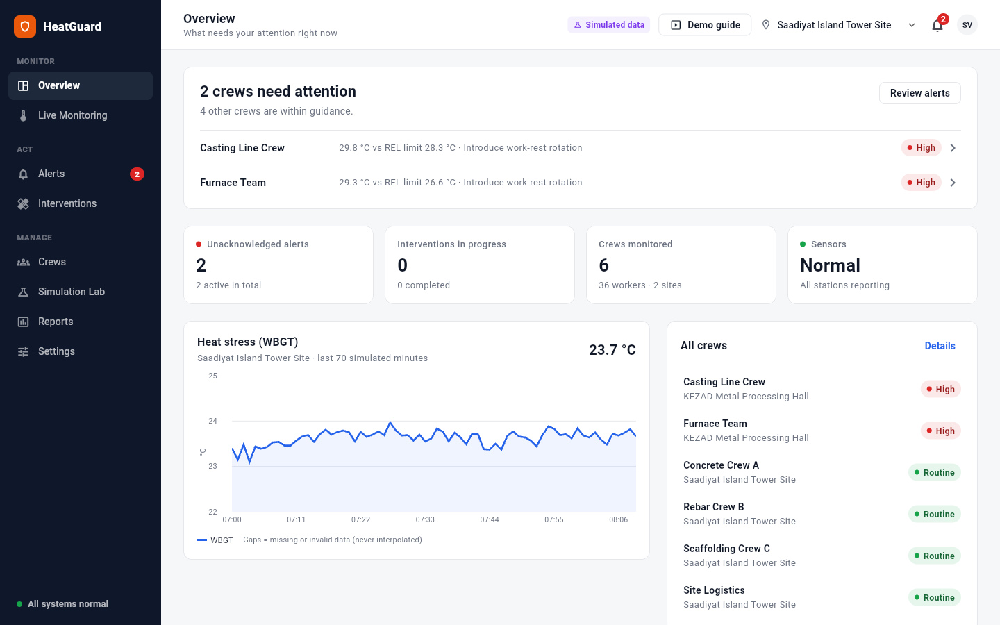
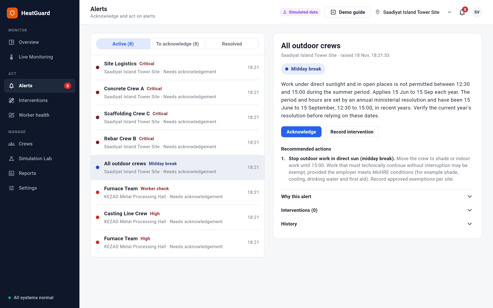
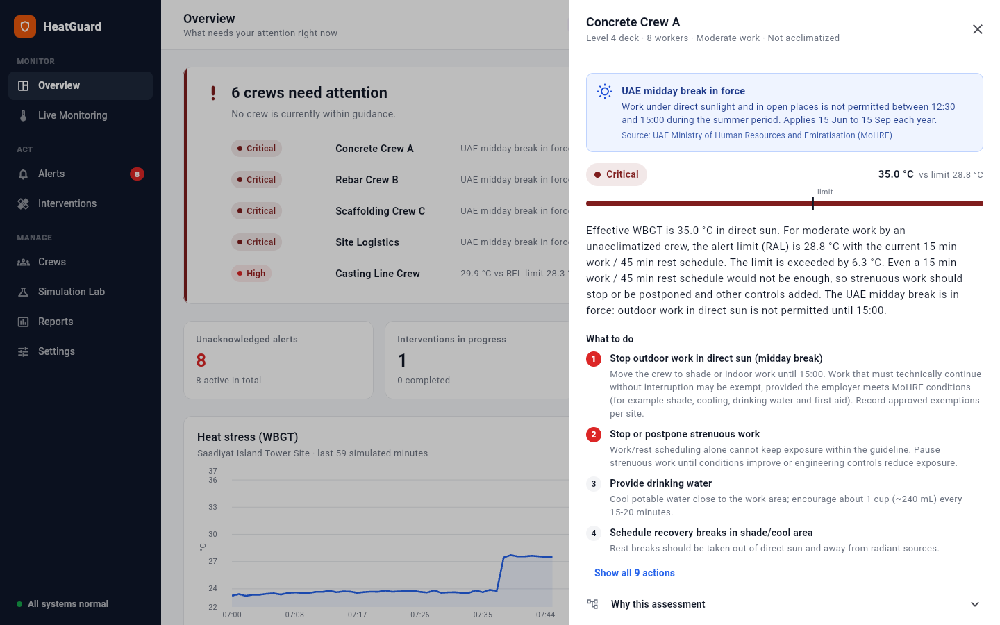
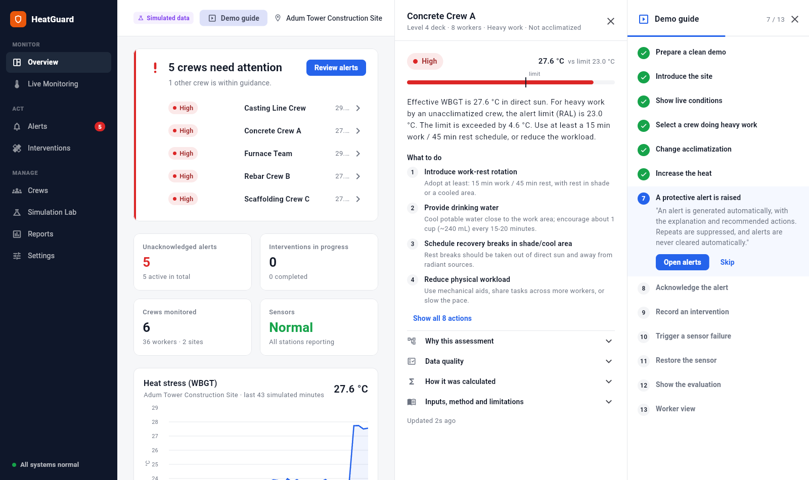
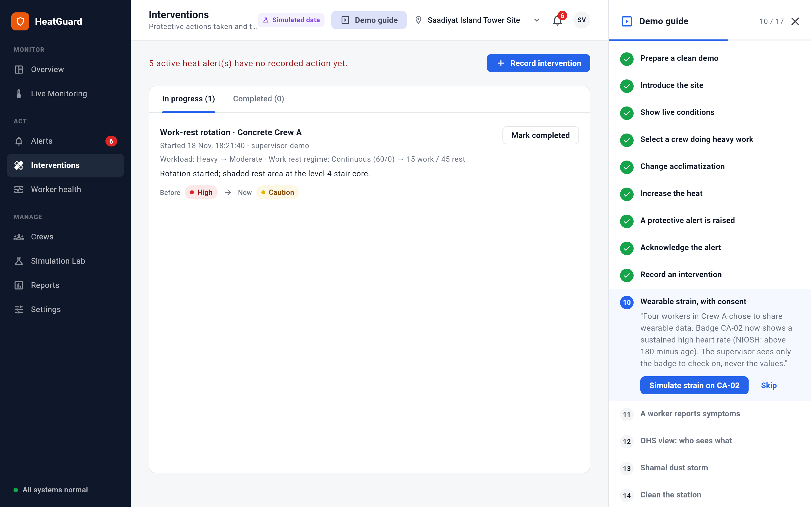
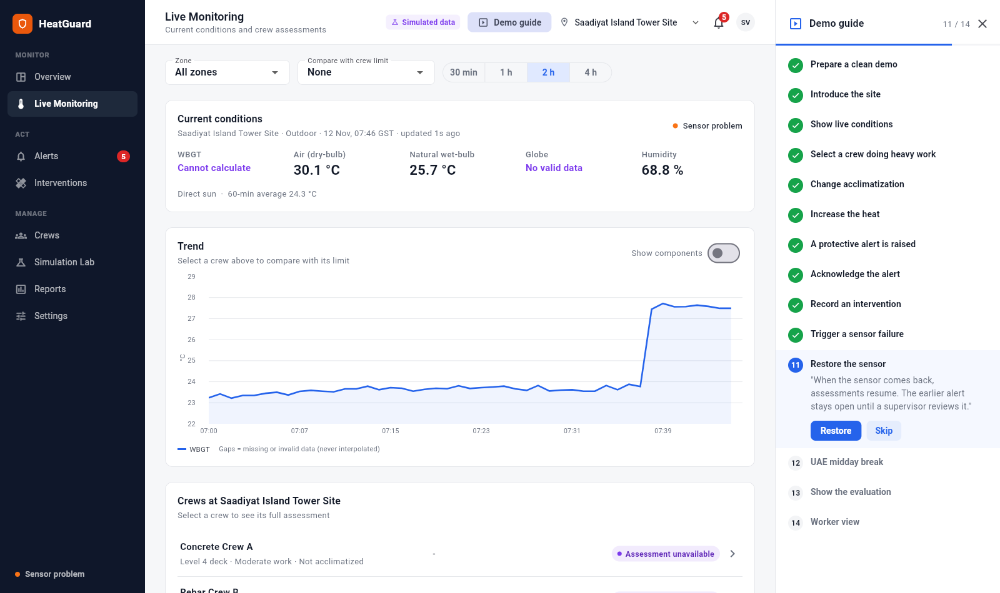
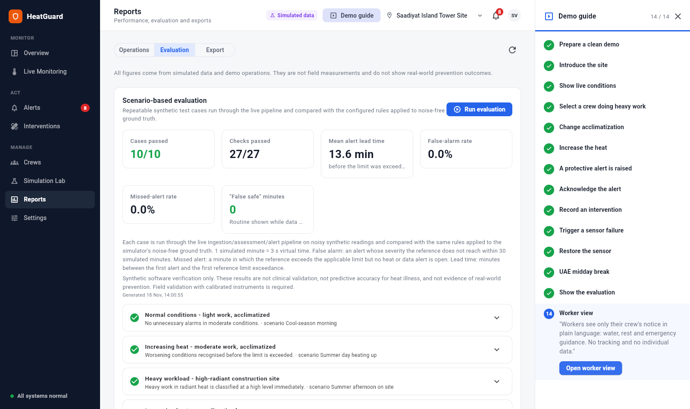
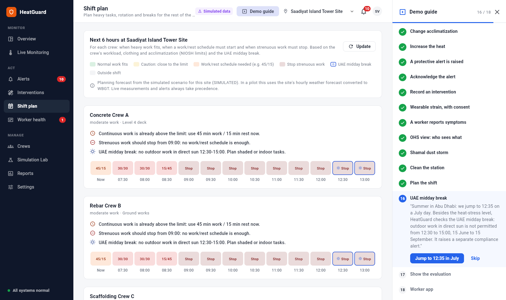
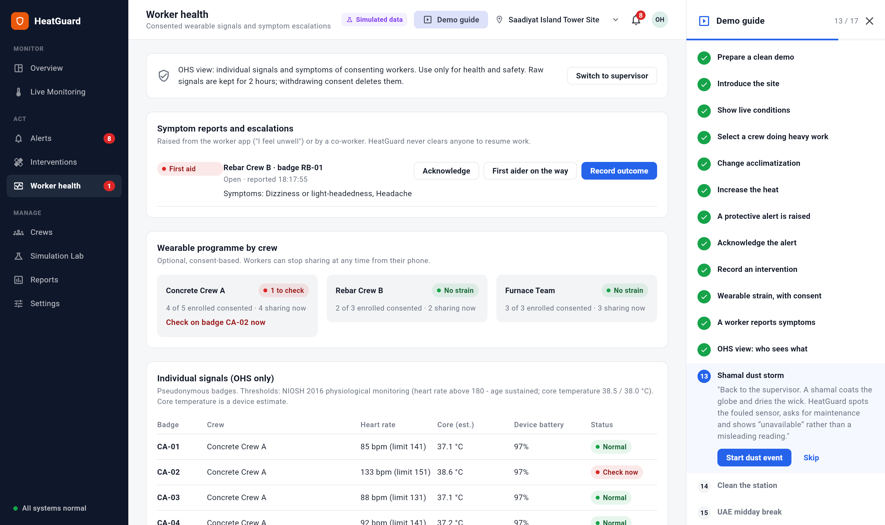
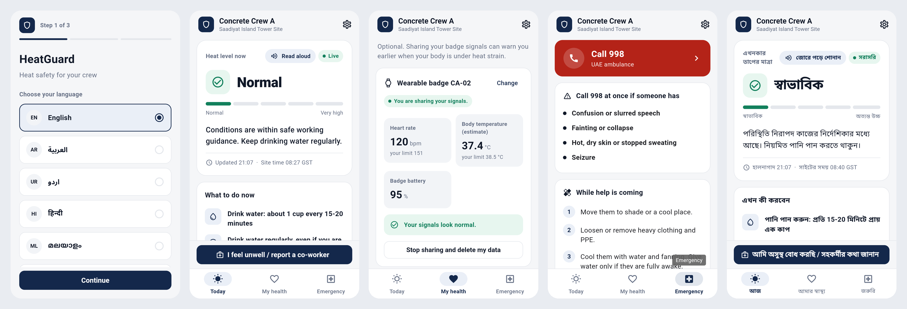

# HeatGuard

[](https://github.com/Fred-pounds/heatguard/actions/workflows/ci.yml)
[](https://render.com/deploy?repo=https://github.com/Fred-pounds/heatguard)

**Explainable occupational heat-risk early warning and intervention system** (hackathon prototype)

**Live demo:** dashboard **https://heatguard-tsl5.onrender.com** · worker app **https://heatguard-tsl5.onrender.com/worker/** (badge CA-02, code `150392`). No login needed.
The free hosting sleeps when idle: the first visit can take about a minute.

> *From environmental monitoring to proactive worker protection.*



## How HeatGuard meets the challenge outcomes

| Desired outcome | What HeatGuard does |
|---|---|
| **Dynamic heat-risk assessment** | Environment (WBGT) + workload + clothing + acclimatization + work/rest schedule, per crew, against NIOSH limits. **Optional consented wearable signals** (heart rate, estimated core temperature) flag individual strain using NIOSH physiological criteria. A **trend outlook** projects when the limit will be reached and raises an early caution. |
| **Clear, graded, multilingual warnings** | Five plain levels plus "unavailable". Actions: hydration, rest, cooling, work-intensity reduction, work/rest rotation, shift change, and **clinical escalation** (first aid or 998). The worker app is available in **six languages** (English, Arabic, Urdu, Hindi, Malayalam, Bengali), can **read the notice aloud**, and alerts the phone (browser notifications). |
| **Worker-first governance** | **Informed consent** with one-tap withdrawal that deletes data; pseudonymous badges whose data only the **phone paired with the badge code** can see; age band only; raw signals kept for 2 h; supervisors see crew counts only; an **OHS-only role** for individual values and symptoms; documented non-punitive use; UAE PDPL. |
| **Field-ready operation** | Abu Dhabi heat and humidity scenarios, **shamal dust** (fouled globe and wick detected), **station and wearable battery**, network outages with edge buffering, PPE clothing adjustments. Every failure falls back to "unavailable", never "safe". |
| **Supervisor decision support** | Crew and site views, a **shift plan** (when heavy work fits, when rotation must start, when strenuous work must stop, midday break), the required work/rest schedule, outlook ("limit in ~25 min"), midday-break countdown, interventions with immediate reassessment, and no unnecessary clinical detail. |
| **Safety and productivity measures** | Alert lead time, false-alarm and missed-alert rates (evaluation), **adherence to recommended controls**, **midday-break compliance**, **symptoms and incidents**, **emergency escalations**, **lost work time**, and acknowledgement times. |

## The problem

In Abu Dhabi, summer air temperatures pass 45 °C and coastal humidity can stay high even in the early morning.
Construction, logistics, oil and gas and industrial crews work outdoors or in hot halls through these conditions.
Supervisors usually see a temperature at best. That doesn't tell them whether a *specific crew*, doing
*specific work* in *specific clothing*, is still within safe limits, whether the UAE midday break applies right
now, or what to do about it.

## What HeatGuard does

1. **Measures** heat stress as WBGT, the standard occupational heat index (here from a simulated station).
2. **Assesses each crew** against documented NIOSH limits, taking workload, clothing and acclimatization into account.
3. **Checks UAE rules:** flags the MoHRE summer midday break (no outdoor work in direct sun 12:30–15:00,
   15 June–15 September) as a separate compliance alert, in Gulf Standard Time.
4. **Explains** every result in plain language: why, what to do, and what data were used or missing.
5. **Alerts and tracks action:** acknowledgement, protective interventions, follow-up reassessment.
6. **Never fakes safety:** missing, invalid or stale data is shown as "assessment unavailable", never as green.

Demo sites (simulated): **Saadiyat Island Tower Site** (outdoor construction) and **KEZAD Metal Processing Hall**
(indoor). The scenarios use Abu Dhabi climate: cool-season mornings, July build-up to midday, humid Gulf-coast
mornings and summer afternoons on site.

| UAE midday break | Explained assessment |
|---|---|
|  |  |
| Explained assessment and guided demo | Intervention tracking |
|---|---|
|  |  |
| **Shamal dust fouls the sensors: never shown as safe** | **Synthetic evaluation** |
|  |  |
| **Shift plan: heavy tasks, rotation and breaks** | **Worker health (OHS role): consented signals, pairing codes** |
|  |  |

**HeatGuard Worker app** (`worker_app/`) is a separate app that workers carry with them. It is not part of the
supervisor dashboard. It runs in any phone browser (and can be added to the home screen) and builds as an Android
or iOS app from the same code. Workers choose their language (English, Arabic, Urdu, Hindi, Malayalam or Bengali; draft translations
with right-to-left layout for Arabic and Urdu), crew and optional badge once. A badge is linked to the phone with the
6-digit code printed on it, so only that phone sees the badge's data. The app remembers them and opens on **Today**: the heat
level, what to do now and the midday break. **My health** has opt-in wearable sharing with consent and deletion.
**Emergency** has a one-tap 998 call, warning signs, first steps and "I feel unwell / report a co-worker". It
alerts the device when the level rises.



> ⚠️ **All sensor data in this prototype are SIMULATED** by a built-in synthetic sensing station and labelled as
> such throughout the UI, API and CSV exports. No physical hardware is required.

<br clear="right">

## What's inside

| | |
|---|---|
| **Simulator** | Physically consistent synthetic Tdb / Tnwb / Tg / RH, 5 scenarios (normal, increasing heat, high-radiant construction, indoor industrial, sensor failure), noise, sensor faults, network outages with edge buffering |
| **WBGT** | Indoor/outdoor ISO 7243 / NIOSH formulas, unit-tested |
| **Risk engine** | NIOSH 2016 REL/RAL equations, metabolic classes, clothing adjustment factors, work/rest regimes. Categories are defined by *which work/rest regime keeps exposure within the limit*, not by invented WBGT cut-offs. Every assessment includes an explanation, contributing factors, recommendations, data quality, method, guideline reference and limitations |
| **Missing data** | Missing, invalid, implausible or stale data and unknown context → *incomplete/unavailable*, **never "safe"** |
| **Alerts** | Duplicate suppression, severity escalation with re-acknowledgement, escalation of unacknowledged alerts, no auto-clear (sustained improvement → supervisor review) |
| **Interventions** | Hydration / cooling break / workload reduction / rotation / shift change / relocation, with optional context changes, immediate reassessment, follow-up timeline and outcome |
| **Dashboard** | Flutter Web (Material 3, Provider, fl_chart): Overview, Live Monitoring, Crew Management, Alerts, Interventions, **Simulation Lab**, Reports (with evaluation and CSV), Settings (methodology and governance) |
| **Worker app** | Separate Flutter app (`worker_app/`) for web, Android and iOS: onboarding, Today / My health / Emergency tabs, 6 languages with RTL, read aloud, badge pairing code, consent, symptom reports, 998 call, device alerts |
| **Persistence** | Firebase Realtime Database via a repository layer, or a local JSON store when no credentials are present; write-behind queue survives outages |
| **Evaluation** | 13 repeatable synthetic cases compared with ground truth: lead time, false/missed alerts, false-safe minutes, completeness, stale detection, recovery |

## Try it

* **Guided demo:** click **Demo guide** in the top bar. It walks through the 5-minute storyline with one-click
  steps (see [docs/demo_script.md](docs/demo_script.md)).
* **Hosted link for judges:** https://heatguard-tsl5.onrender.com (worker app: https://heatguard-tsl5.onrender.com/worker/). To host your own copy, click *Deploy to Render* above, or run the Docker image anywhere
  (`docker build -t heatguard . && docker run -p 8000:8000 heatguard`). The free Render plan sleeps when idle and
  resets its demo data on restart.

## Quick start

### Fastest: Python only (prebuilt dashboard included)

```bash
git clone https://github.com/Fred-pounds/heatguard.git
cd heatguard/backend
pip install -r requirements.txt
python -m uvicorn app.main:app --port 8000
```

Open **http://localhost:8000** for the supervisor dashboard and **http://localhost:8000/worker/** for the worker
app. Prebuilt copies of both ship in `frontend/dist` and `worker_app/dist`, so Flutter is only needed if you change
them. With uv, use `uv pip install -r requirements.txt` instead of `pip install`.

### Requirements for development
* Python 3.11+
* Flutter 3.24+ with web support (developed on Flutter 3.50 / Dart 3.11)

### One command (API + dashboard on one port)

```bash
./scripts/run_demo.sh
```

This installs the Python requirements (with uv or pip) and serves everything on one port: the dashboard at
**http://localhost:8000** and the worker app at **http://localhost:8000/worker/**.

**Demo badge codes:** in the dashboard switch to the OHS role (account menu) and open **Worker health**; each badge's
pairing code is listed there (for example CA-02: `150392`).

**Worker app on a phone:** connect the phone to the same Wi-Fi as the laptop and open
`http://<laptop-ip>:8000/worker/`. In the browser menu choose *Add to Home screen* to install it like an app.

### Or run the parts separately

Backend (in local demo mode, no Firebase credentials needed):

```bash
cd backend
pip install -r requirements.txt
cp .env.example .env
uvicorn app.main:app --reload --port 8000
```

API docs are at http://localhost:8000/docs.

Frontend (development):

```bash
cd frontend
flutter pub get
flutter run -d chrome --dart-define=API_BASE_URL=http://localhost:8000/api
```

Worker app (development):

```bash
cd worker_app
flutter pub get
flutter run -d chrome --dart-define=API_BASE_URL=http://localhost:8000/api
```

Release web builds of both apps, served by the backend:

```bash
./scripts/build_web.sh
```

This builds `frontend` (served at `/`) and `worker_app` with `--base-href /worker/` (served at `/worker/`), and
refreshes their committed `dist` folders. For each app the backend serves whichever of `build/web` and `dist` is
newer. CanvasKit and the fonts (Roboto, Noto Sans Arabic and Devanagari) are bundled, so the demo works offline.

Worker app as an Android or iOS app (needs the Android SDK or Xcode on your machine):

```bash
cd worker_app && flutter build apk --dart-define=API_BASE_URL=http://<laptop-ip>:8000/api
```

```bash
cd worker_app && flutter build ios --dart-define=API_BASE_URL=http://<laptop-ip>:8000/api
```

The server address can also be changed in the app under **Settings → Server address**. Plain HTTP to a local
demo server is allowed in the Android and iOS projects; use HTTPS for any real deployment.

### Tests

```bash
cd backend && python -m pytest app/tests -q          # 44 unit, API and evaluation tests
```

```bash
cd frontend && flutter analyze && flutter test        # dashboard: static analysis + unit tests
```

```bash
cd worker_app && flutter analyze && flutter test      # worker app: static analysis + unit tests
```

```bash
cd firebase && firebase emulators:exec --only database --project demo-heatguard "cd ../backend && python -m pytest app/tests/test_firebase_emulator.py -q"
```

CI (GitHub Actions) runs all of these plus the Docker build on every push.

## Firebase Realtime Database (optional)

1. Create a Firebase project with a Realtime Database.
2. Download a service-account key (Project settings → Service accounts). **Do not commit it.**
3. In `backend/.env` set:
   ```
   HEATGUARD_STORAGE=firebase
   FIREBASE_CREDENTIALS=/absolute/path/to/service-account.json
   FIREBASE_DATABASE_URL=https://<project>-default-rtdb.<region>.firebasedatabase.app
   ```
4. Deploy the rules: `cd firebase && firebase deploy --only database`.

**Emulator (no Firebase account needed):** run `firebase emulators:start --only database --project demo-heatguard`
inside `firebase/`, then start the backend with:

```bash
HEATGUARD_STORAGE=firebase FIREBASE_DATABASE_EMULATOR_HOST=127.0.0.1:9000 FIREBASE_DATABASE_URL="http://127.0.0.1:9000?ns=demo-heatguard" python -m uvicorn app.main:app --port 8000
```

Verified against the emulator:
* All collections are written.
* State reloads after a restart.
* Writes queue during a database outage and flush on recovery.
* The security rules deny unauthenticated reads.

Without credentials HeatGuard falls back to `backend/data/local_store.json`, which mirrors the same tree.
If Firebase is unreachable, writes queue up. The sidebar shows the queue as "unsynced", and the Simulation Lab
can simulate a database outage.

> Firebase **Authentication** is not wired up in this MVP. Roles are passed as an `X-HeatGuard-Role` demo
> header. The RTDB rules already expect `role` / `crew_id` custom claims. See `docs/data_governance.md`.

## External / ESP32 stations

`POST /api/sensors/ingest` accepts readings from any station, with an optional `X-HeatGuard-Key` if
`HEATGUARD_INGEST_KEY` is set. `simulator/simulator.py` is a standalone client that uses this path:

```bash
cd backend && HEATGUARD_SIM_AUTOSTART=false uvicorn app.main:app --port 8000
```

```bash
python simulator/simulator.py --worksite ws_saadiyat_tower --scenario increasing_heat --interval 3
```

## Project structure

```
heatguard/
├── backend/app/
│   ├── main.py                    FastAPI app (+ serves the dashboard at / and the worker app at /worker/)
│   ├── api/routes/                simulation, sensors, assessments, alerts, crews, interventions, reports, system
│   ├── core/                      config (env vars), security (demo roles, ingest key)
│   ├── guidelines/niosh_2016.json documented assessment configuration
│   ├── schemas/                   Pydantic models
│   ├── sensors/                   SensorSource interface + simulated adapter
│   ├── services/                  wbgt_calculator, data_validation, guideline, risk_engine, alert_engine,
│   │                              intervention_service, simulation_service, heatguard_service,
│   │                              reports_service, evaluation_service
│   ├── repositories/              repository + Firebase / local JSON backends
│   └── tests/
├── simulator/                     heatguard_sim (physics, scenarios, station) + standalone simulator.py
├── frontend/lib/                  supervisor / OHS dashboard: app shell, core, models, services, providers,
│                                  widgets, features/{overview,monitoring,crews,alerts,interventions,health,
│                                  simulation,reports,settings,demo}
├── worker_app/                    HeatGuard Worker app (web, Android, iOS): lib/{core,l10n,ui}, android/, ios/, web/
├── firebase/                      database.rules.json, firebase.json
├── docs/                          architecture, risk_methodology, data_governance, evaluation, demo_script, screenshots
├── scripts/run_demo.sh, build_web.sh
├── Dockerfile, render.yaml        container + one-click hosted deploy
└── .github/workflows/ci.yml       backend, frontend, Firebase-emulator and Docker checks
```

## Documentation

* [Architecture](docs/architecture.md)
* [Risk methodology](docs/risk_methodology.md): guideline, equations, categories, missing data
* [Data governance](docs/data_governance.md)
* [Evaluation](docs/evaluation.md): method, metric definitions, results
* [5-minute demo script](docs/demo_script.md)
* [Business model and market (draft)](docs/business_model.md): sources, assumed prices, alternatives
* [Submission deck](docs/submission/HeatGuard_Submission.pdf)

## Limitations

* All data are synthetic. Nothing has been validated in the field.
* NIOSH RAL/REL apply to healthy workers. Metabolic rates are category estimates, and screening is a
  conservative approximation of a 1-hour TWA.
* The simulator's physics is a consistency heuristic, not a validated thermal model.
* The demo role header is not authentication. The Arabic, Urdu and Hindi texts are drafts that need qualified native-speaker review
  before use. The wearable physiology is a simple synthetic model; real devices and their core-temperature estimates must be validated
  before use.
* Not a medical device. It does not diagnose, predict illness or clear workers to resume work.

## Acceptance checklist

- [x] Backend starts; Flutter Web app builds and runs against it
- [x] Firebase integration (Admin SDK repository, rules), with local demo store fallback
- [x] Simulator generates readings; 5 scenarios selectable; WBGT formulas unit-tested
- [x] Workload / acclimatization / clothing / work-rest changes reassess immediately
- [x] Structured, explained assessments; missing data → incomplete; sensor and network failure handled safely
- [x] Alerts generated, acknowledged, escalated, resolved with notes; interventions recorded with follow-up
- [x] Live dashboard, trends, interactive Simulation Lab, reports, CSV export, SIMULATED labelling
- [x] Methodology documentation; backend, frontend and Firebase-emulator tests in CI; evaluation suite (13 cases / 35 checks passing)
- [x] Guided in-app demo mode; Docker image and Render blueprint for a hosted link
- [x] Consented wearable signals, symptom escalation, OHS role, multilingual worker app (EN/AR/UR/HI), dust and battery handling, trend outlook, safety and productivity metrics
- [x] Abu Dhabi localization: UAE climate scenarios, MoHRE midday-break compliance rule, GST site time, 998 ambulance, UAE PDPL
